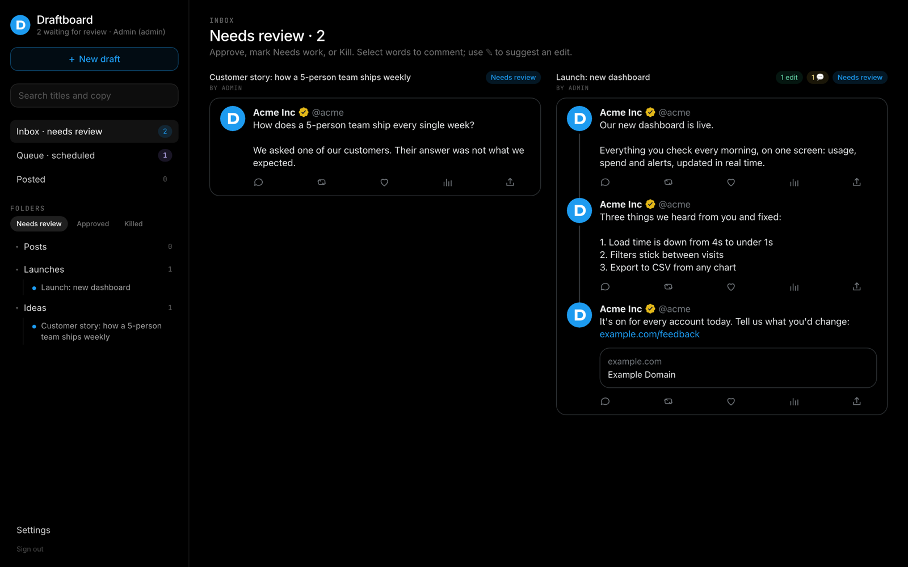
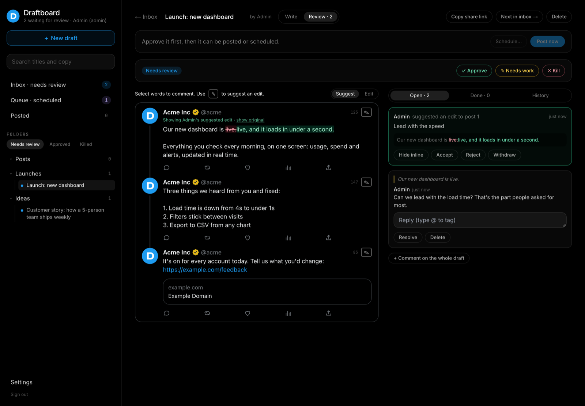
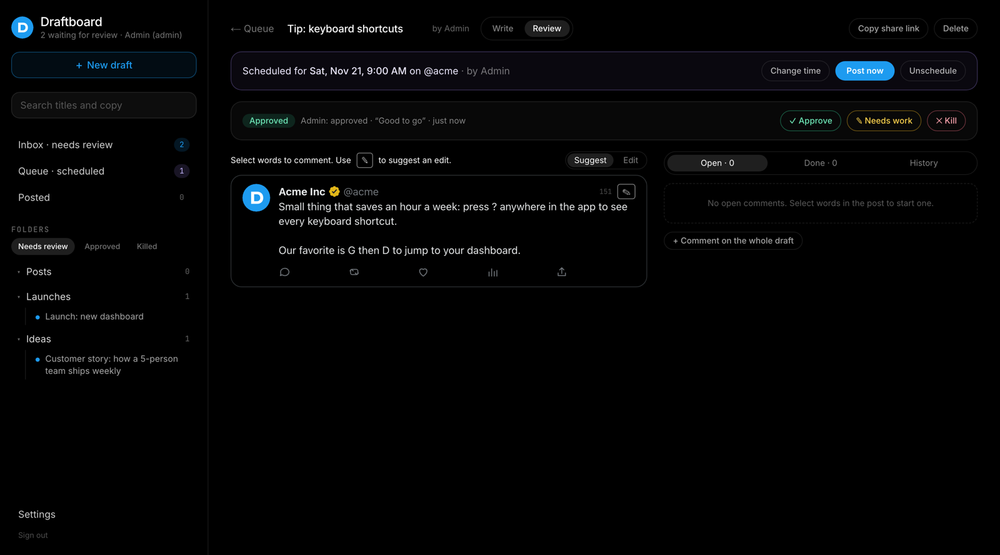

# Draftboard

A drafts board for your team's X account. Write posts and threads in an editor that looks like X, review them
together (comments on highlighted words, tracked-change suggestions, approve / needs work / kill), then post them or
schedule them to your company's X account. Like a shared Typefully with a review step built in, running on your own
infrastructure, behind your company's Google sign-in.



## What it does

- **Write like you're on X.** The preview is the editor: threads, images and video, alt text, @mentions checked
  against X, $cashtags, link cards, quote posts, a 280-character count, and a feed preview with "Show more". Autosaves.
- **Review together.** Select words to comment, suggest edits as tracked changes the writer accepts or rejects, reply
  and resolve, @tag teammates. Approve, send back, or kill. Full version history with restore.
- **Post and schedule.** Connect your company's X account once. Admins post approved drafts now or pick a time; a
  queue shows what's going out when. Threads post in order; if one fails halfway, retry finishes it without
  repeating the posts that went out. Editing a draft after approval holds it until someone approves it again.
- **Only your team gets in.** Google sign-in limited to your email domain(s), with admins you choose.
- **Yours to brand.** Name, logo, colors, font, folders and posting rules live in one file.
- **Extras.** Share links that unfurl with the copy and image in Slack, drag-and-drop folders, optional Slack DMs
  for comments, edits, approvals and posts.

| Review | Scheduled |
|---|---|
|  |  |

## Set it up with Claude Code (recommended)

This repo is built to be set up by [Claude Code](https://claude.com/claude-code). It knows the codebase
(`CLAUDE.md`) and has a guided setup (`.claude/skills/setup`) that walks you through every step and does the code
changes for you:

1. **Use this template** (or fork) on GitHub, and clone your copy.
2. In the folder, start Claude Code and say **"set this up for my team"** (or type `/setup`).
3. Claude asks for your board's name, your website (to pull your brand colors and logo) and your folders, rebrands the
   app, runs it on your machine, then walks you through deploying it, Google sign-in, connecting X and the scheduler.

You stay in charge of anything secret or paid: Claude tells you exactly where to paste each key (your Vercel
dashboard or `.env.local`) and never asks for them in the chat. Each step can also be run on its own later
("rebrand it", "connect X", "add Slack").

## Try it locally in two minutes

No accounts needed: locally it uses a built-in database and saves uploads to disk.

```bash
git clone <your copy> draftboard && cd draftboard
npm install
cp .env.example .env.local   # then set DEV_USER and ADMIN_EMAILS to your email
npm run dev                  # http://localhost:3000
npm run demo                 # in another terminal: adds a few sample drafts
```

`DEV_USER` signs you in without Google and is ignored in production builds.

## Set it up by hand

| Step | Guide |
|---|---|
| Brand it: name, logo, colors, font, folders, posting rules | [docs/branding.md](docs/branding.md) |
| Deploy to Vercel with Postgres and Blob storage | [docs/deploy.md](docs/deploy.md) |
| Google sign-in, limited to your domain | [docs/google-oauth.md](docs/google-oauth.md) |
| Connect your X account (and what X's API costs) | [docs/x-api.md](docs/x-api.md) |
| The scheduler | [docs/scheduling.md](docs/scheduling.md) |
| Slack notifications (optional) | [docs/slack.md](docs/slack.md) |

`npm run check:setup` lists what's still missing. Every setting is in [.env.example](.env.example).

## What it costs to run

- **Vercel**: the free Hobby plan works. Scheduled posts then go out within about 15 minutes of their time (or every
  minute with a free external pinger, see [docs/scheduling.md](docs/scheduling.md)); Pro posts on the minute.
- **Postgres**: Neon's free tier is plenty for a team's drafts.
- **X API**: pay-per-use credits, roughly $0.015 per post and $0.20 for a post with a link (late 2026 prices).
  See [docs/x-api.md](docs/x-api.md).

## How it's built

Next.js 15 (App Router), React 19, Tailwind 3, Auth.js (Google), Postgres (any provider, via `postgres`; PGlite
locally), Vercel Blob, X API v2 with OAuth 2.0. No other services. The map of the code is in [CLAUDE.md](CLAUDE.md).

Roles: everyone who can sign in writes, comments, suggests and gives verdicts; a draft's writer edits it directly;
admins (`ADMIN_EMAILS`) also connect X, delete and reorder drafts, and post and schedule.

## License

MIT
