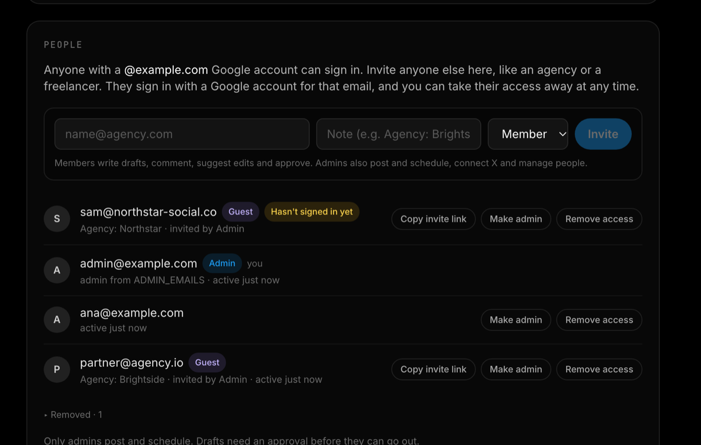

# People: your team, guests and admins

## Who can sign in

- **Your company.** Anyone with an email on `ALLOWED_EMAIL_DOMAINS` (e.g. `acme.com`) can sign in from day one.
  Nobody has to add them.
- **Guests.** Anyone else, like an agency, a freelancer or a partner, gets in once an admin invites them in
  **Settings → People**. From then on they can sign in any time, whatever their email domain.
- **Admins.** The first admins come from `ADMIN_EMAILS`. Admins can make anyone else an admin in Settings → People.

The check runs on every request, so **Remove access** works on that person's next click, not when their login expires.
Removed people stay listed under "Removed" with a **Give access back** button.

## Inviting someone

Settings → People → enter their email, an optional note ("Agency: Brightside"), and Member or Admin → **Invite**.

- With email set up (below), they get an email with a link to the board.
- Without it, the invite link is copied for you. Send it however you like (Slack, email). The link just opens the
  sign-in page with their address filled in; what lets them in is their email being on the list, so a forwarded link
  is useless to anyone else.

What guests can do is the same as any member: write drafts, comment, suggest edits and give verdicts. Make them an
admin only if they should post, schedule, connect X or manage people.

## How guests sign in

- **With Google**, if their email is a Google account (Gmail, or their own company's Google Workspace). Any email
  address can be made into a Google account at accounts.google.com/signup ("use your existing email").
  For this to work, your Google sign-in must be set to **External** audience (see
  [google-oauth.md](google-oauth.md)): **Internal** stops anyone outside your Google Workspace at Google's door.
- **With an email link** (optional, recommended if you work with agencies): they type their email, get a one-time
  link that works for 30 minutes, and they're in. No Google account needed.

## Turning on email links and invite emails

Draftboard sends email through [Resend](https://resend.com) (free tier: 3,000 emails a month).

1. Create a Resend account and **add your domain** (Resend → Domains). Add the DNS records it shows you, and wait for
   it to verify. Sending from a domain you own keeps the emails out of spam.
2. Resend → API Keys → create a key with "Sending access".
3. Add to Vercel (and `.env.local` to test locally), then redeploy:

| Name | Value |
|---|---|
| `AUTH_RESEND_KEY` | the Resend API key |
| `EMAIL_FROM` | who the emails come from, on the domain you verified: `Acme Drafts <drafts@acme.com>` |

The sign-in page then shows "Email me a sign-in link", and invites are emailed. It only sends a link to people who
have access; anyone else sees the same "check your email" message and gets nothing, so the form doesn't reveal who's
on the list.

## The environment settings

`ALLOWED_EMAILS` (individual addresses) and `ADMIN_EMAILS` still work and always win: you can't remove or demote
those people from the app. Use them for the first admins; use Settings → People for everyone else.
